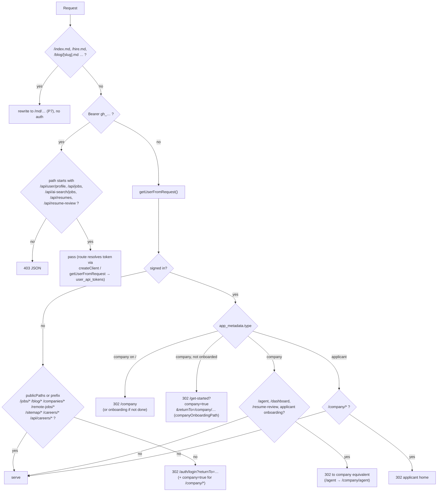
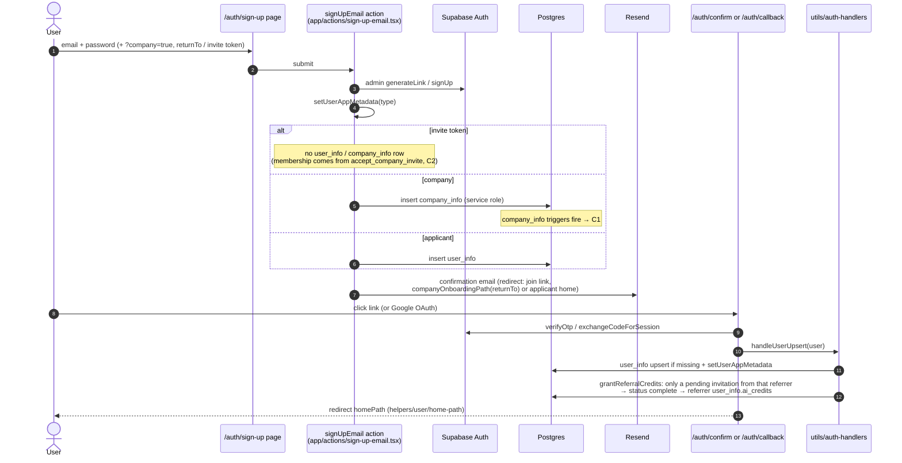
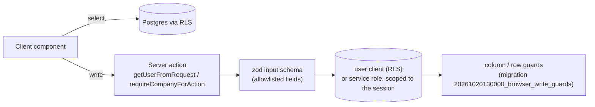
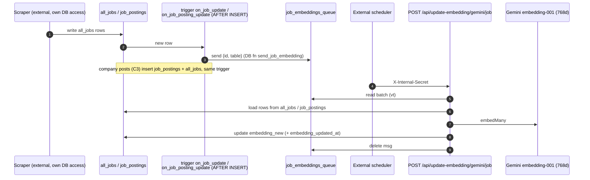
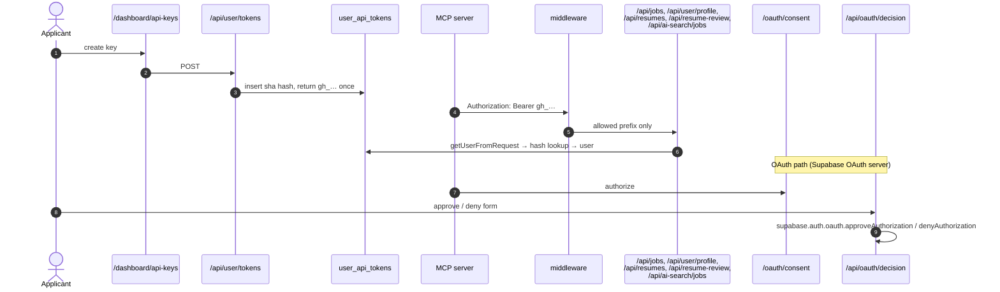
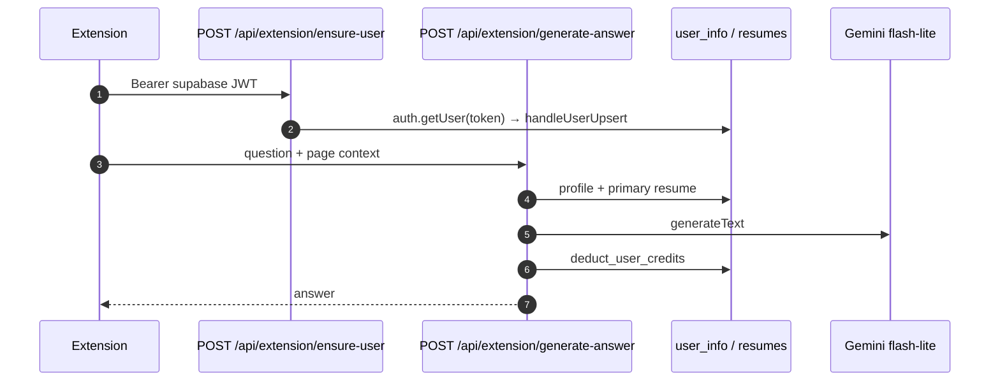
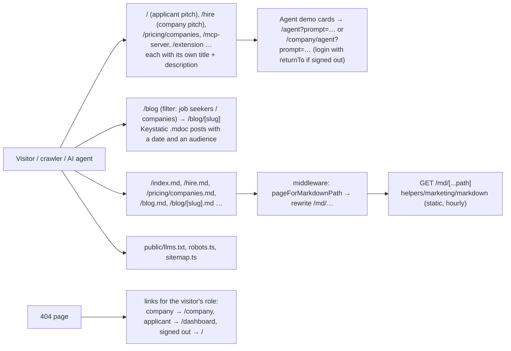

# Platform flows

## P1. Request routing (`middleware.ts` → `lib/supabase/middleware.ts`)

`returnTo` is checked by `safeReturnPath` (`helpers/user/home-path.ts`), so only same-site paths are kept. After signing in, `login-form` calls `clearRouterCacheAction` so the browser doesn't replay a cached redirect to login.

## P2. Sign-up, email confirm, OAuth, invite sign-up

## P3. The browser only reads; writes go through server actions

The browser Supabase client (`lib/supabase/client.ts`) is used for reads only; `test/no-browser-writes.test.ts` fails the build if a component inserts, updates, deletes or calls an RPC with it. Every write is a server action that validates its input with zod and takes the user (or company) from the session, never from the input.

The guards make direct REST calls with a user's own token harmless:

| Table | Guard |
|---|---|
| `user_info` | `protect_user_info_columns`: users can't change their email (except to their verified one), `invitations_count`, `referral_code` or the embedding |
| `applications` | users insert and delete only external rows (`job_post_id` null); platform applications are inserted by the service role inside `submitApplicationAction`; answers, form snapshot and resume are fixed after submit |
| `invitations` | read and mark-as-shown only |
| `interviews` | `charged_session_ids` belongs to the charge RPC |
| `bookmarks` | at most 5 active job alerts per user |

## P4. Job ingestion and embeddings (scraped jobs + company posts)

## P5. API keys, MCP and OAuth

## P6. Browser extension

## P7. Public pages, blog and markdown for AI agents

