# Applicant flows

## Applicant journey at a glance

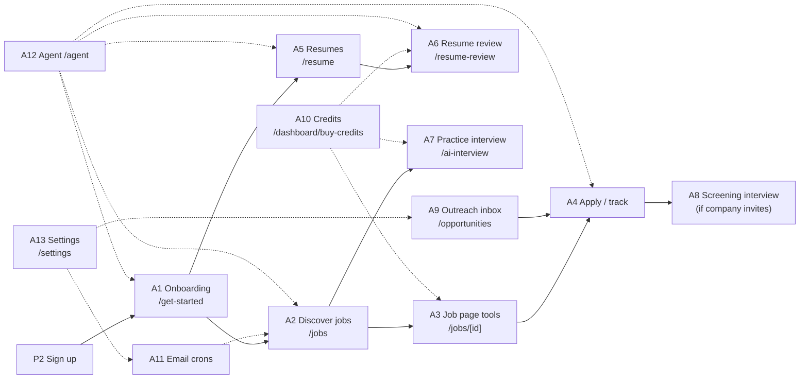

## A1. Onboarding

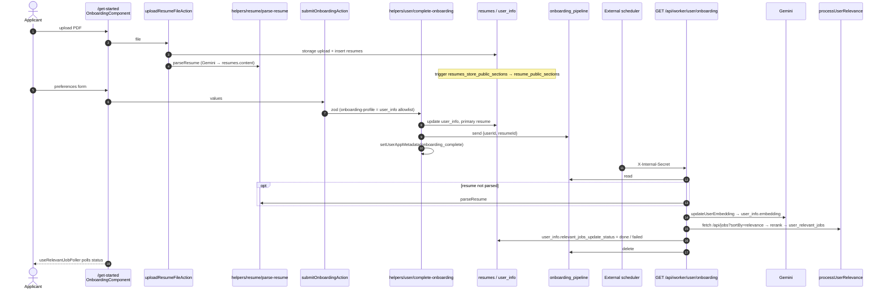

## A2. Job discovery and search

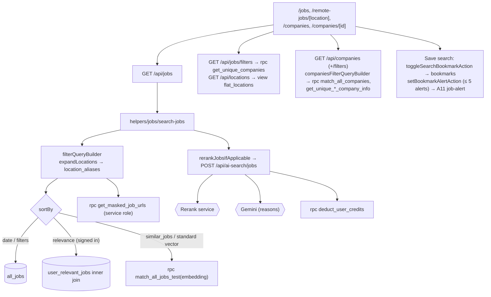

## A3. Job page tools (`/jobs/[job_id]`)

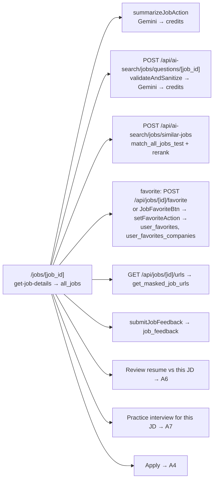

## A4. Apply

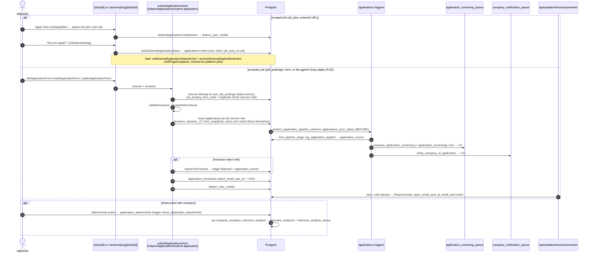

## A5. Resumes (`/resume`, `/resume/[id]`)

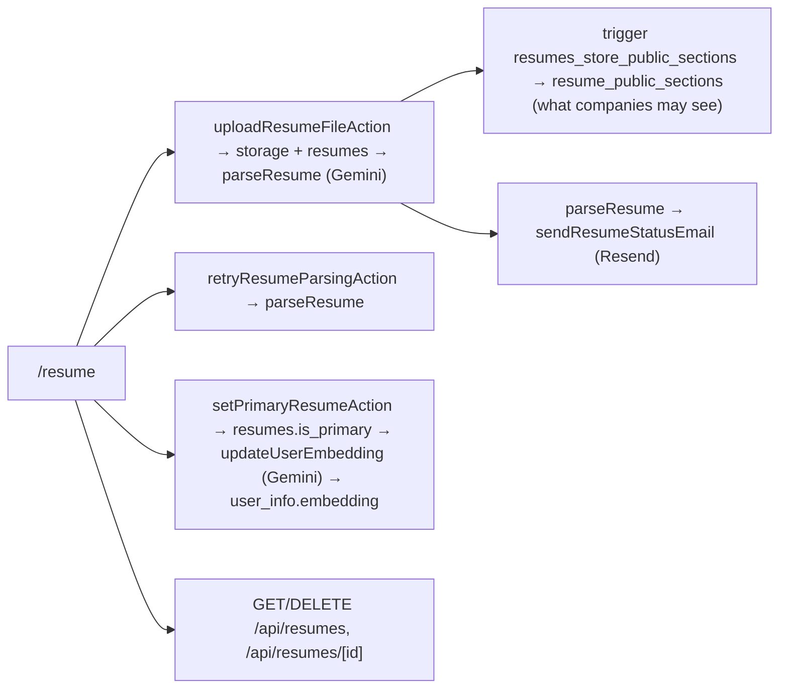

## A6. Resume review

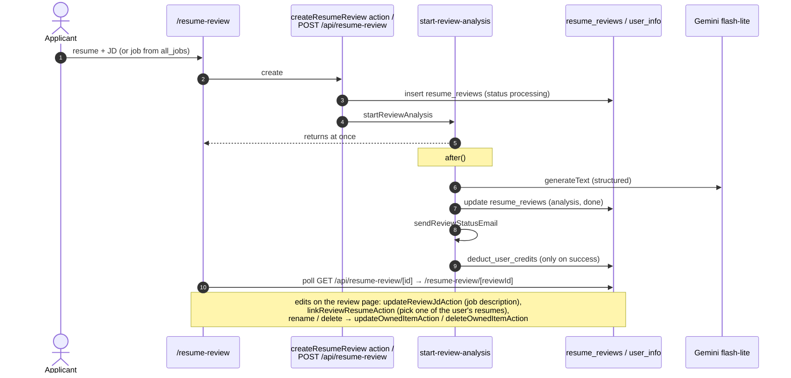

## A7. Practice interview (voice)

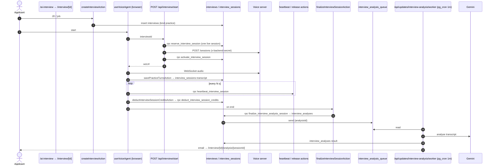

## A8. Screening interview (candidate side)

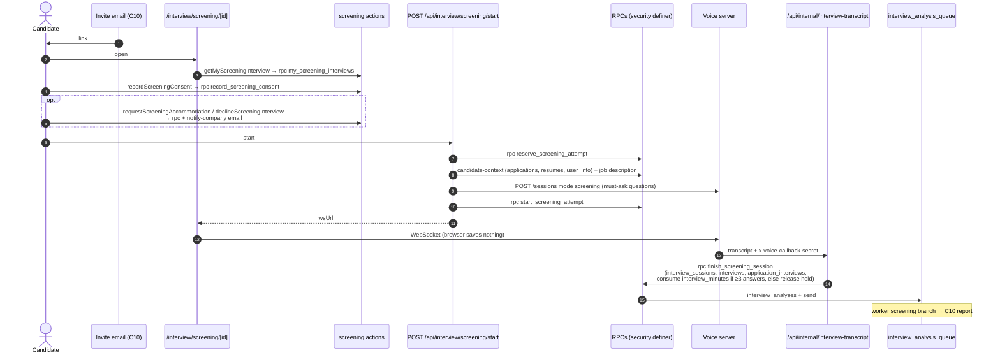

## A9. Outreach inbox (`/opportunities`)

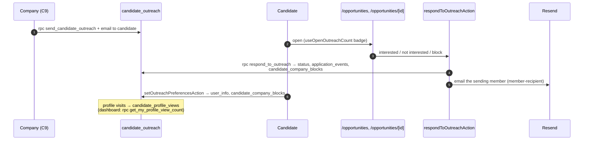

## A10. Credits and payments

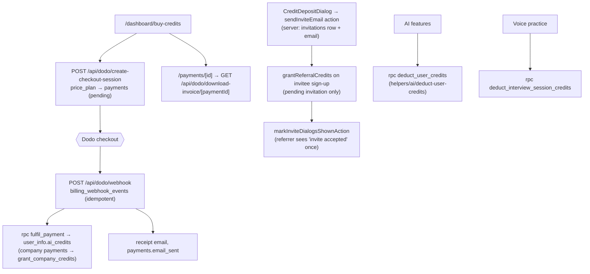

## A11. Applicant email crons (external scheduler)

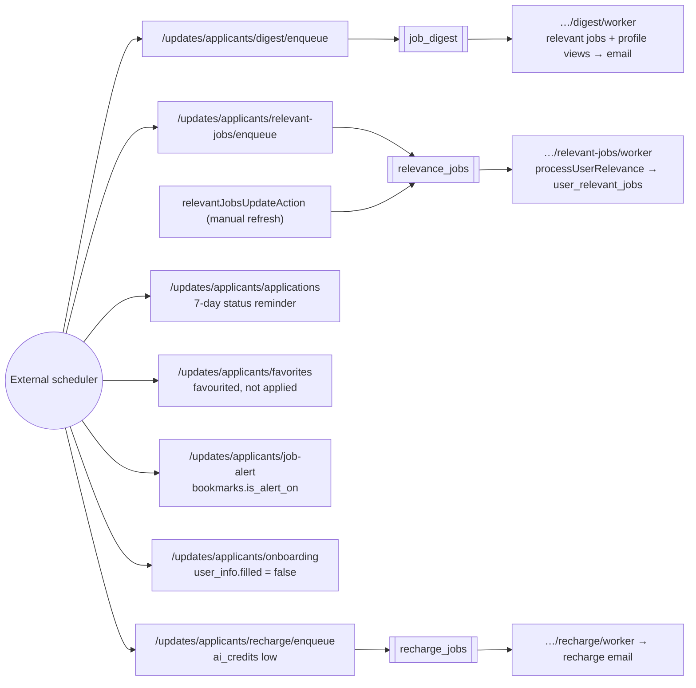

## A12. Agent (applicant role)

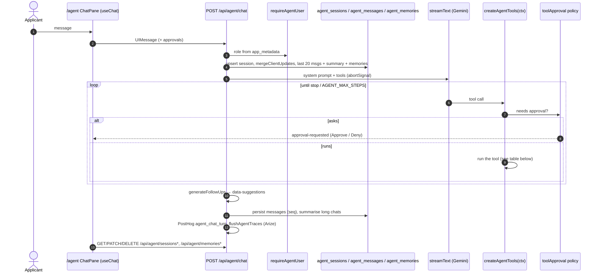

Applicant tools (`helpers/agent/tools/`). The ones marked **asks** show an Approve / Deny card first (`helpers/agent/approval.ts`).

| Group | Tools |
|---|---|
| Profile + onboarding | `getMyProfile`, `updateMyPreferences` (**asks**), `completeOnboarding` (**asks**) |
| Jobs | `searchJobs`, `naturalLanguageJobSearch`, `findRelevantJobs`, `findSimilarJobs`, `getJobDetails`, `saveJob`, `unsaveJob`, `listSavedJobs` |
| Applications | `listApplications`, `updateApplicationStatus` (external jobs only), `getApplicationForm`, `submitApplication`: Easy Apply through the same `submitApplication` helper as the form (A4), 1 credit (**asks**, card from `previewAgentApplicationAction`) |
| Resumes | `listResumes`, `setPrimaryResume`, `requestResumeUpload`, `pickResumeForJob` (`helpers/resume-review/rank-resumes-for-job`, `shortlist-resumes`), `startResumeReview` (**asks**), `getResumeReview` |
| Interviews | `listInterviews`, `listScreeningInterviews`, `getInterviewAnalysis`, `createInterview` |
| Memory | `saveMemory`, `deleteMemory` |

## A13. Settings (`/settings`)

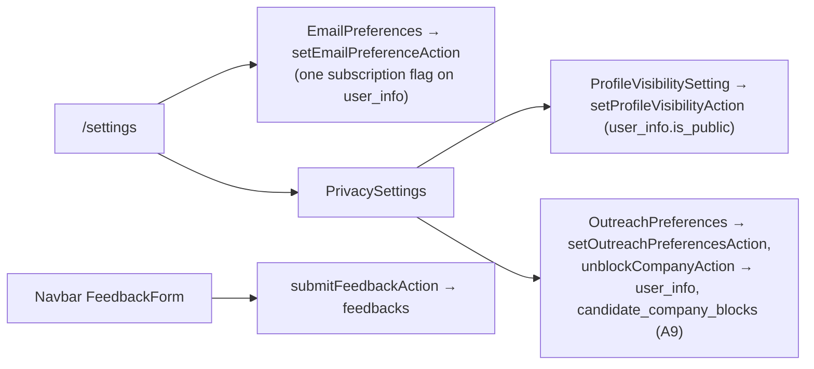
