# Company flows

## Company journey at a glance

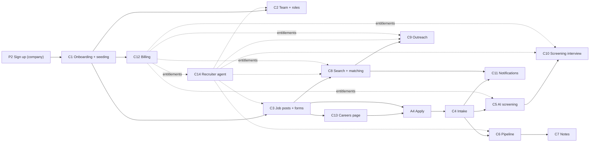

## Permission check (every company action / route / tool)

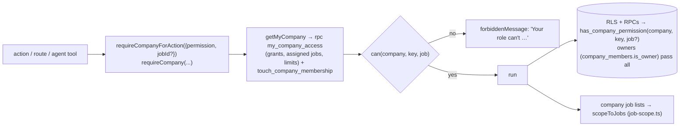

## C1. Company onboarding and seeding

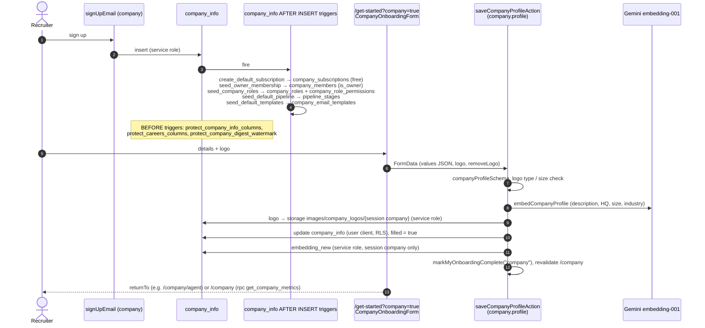

## C2. Team, roles, hiring teams

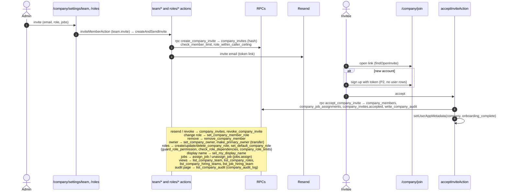

## C3. Job posts, forms, question sets

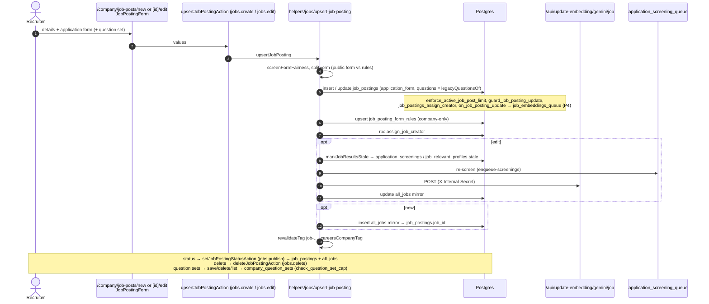

## C4. Application intake (what one apply sets off)

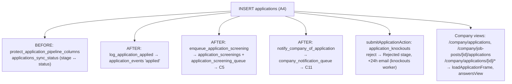

## C5. AI screening of applications

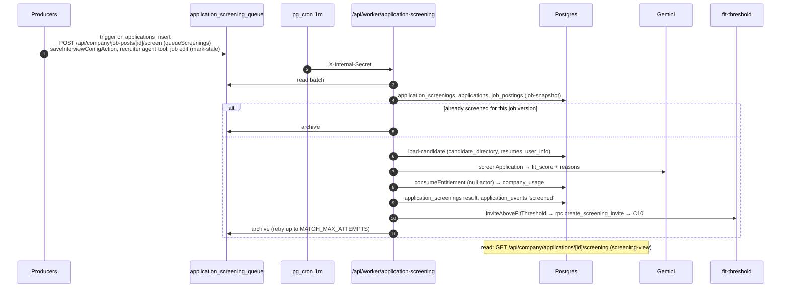

## C6. Pipeline (board, stages, emails)

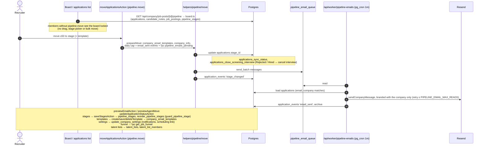

## C7. Notes and mentions

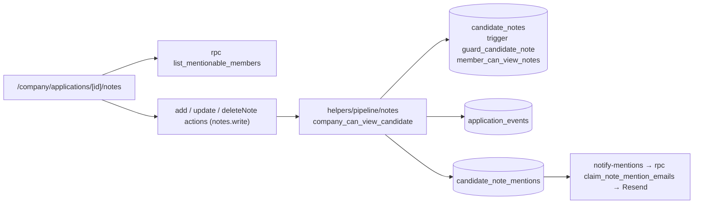

## C8. Candidate search and matching

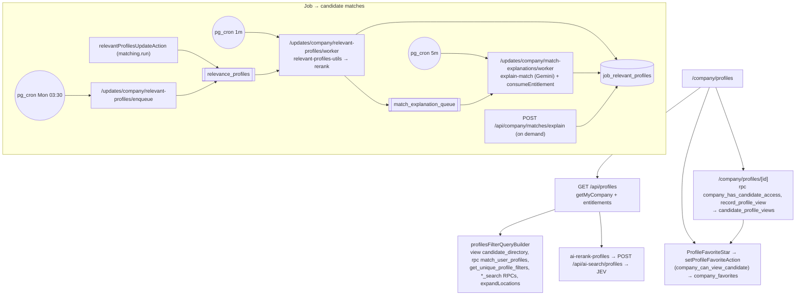

## C9. Outreach

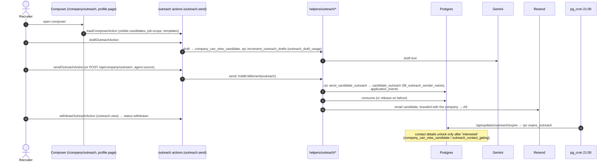

## C10. Screening interviews (company side)

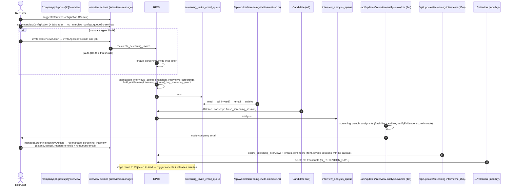

## C11. Company notifications

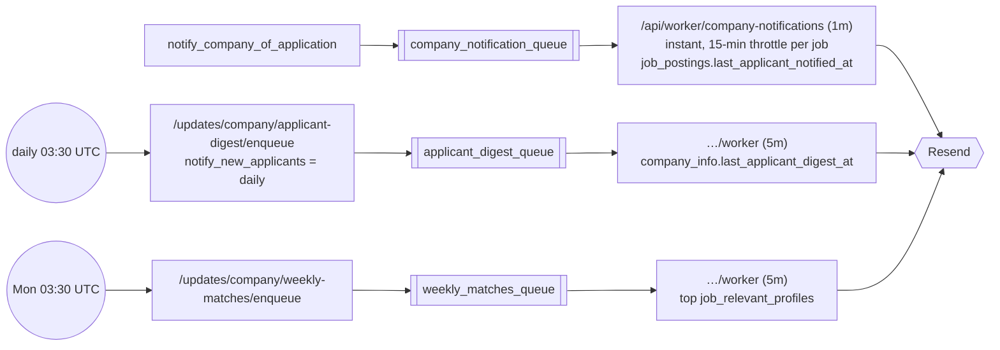

## C12. Billing and entitlements

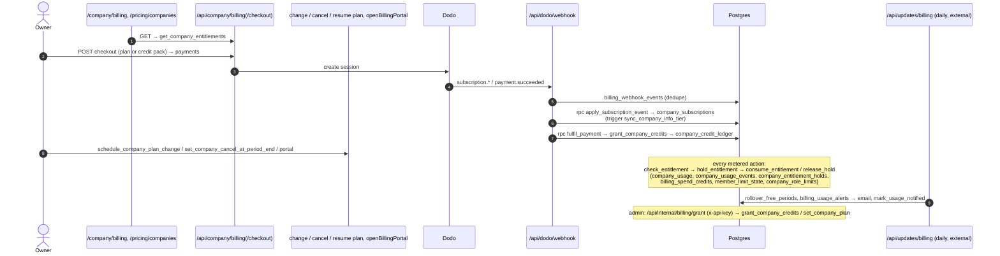

## C13. Careers page

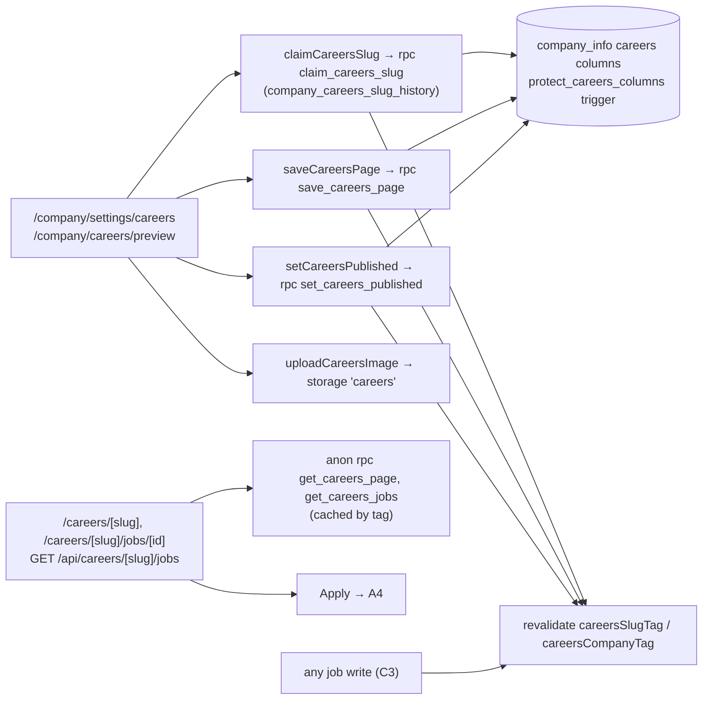

## C14. Recruiter agent (`/company/agent`)

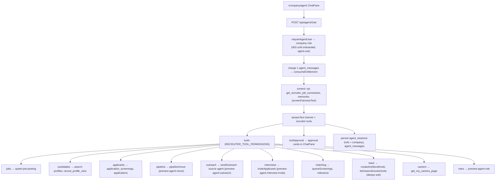
