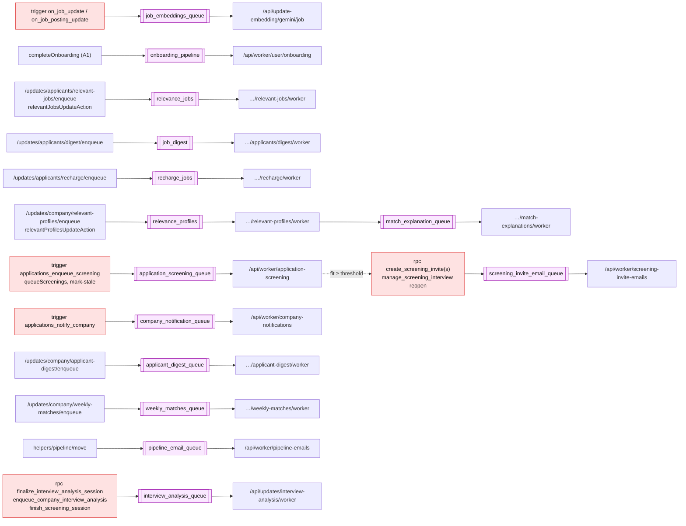
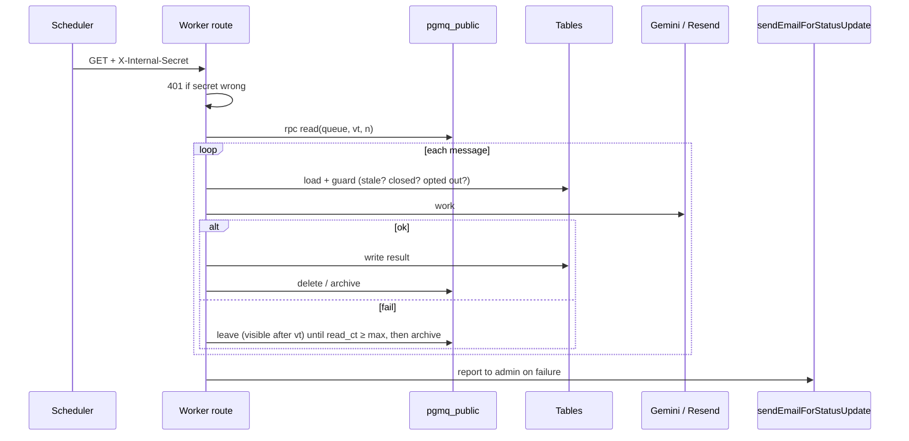

# Background jobs: queues and crons

Two schedulers call the worker routes, both with `X-Internal-Secret`:
- **pg_cron** (`net.http_get`, secret from `vault.internal_secret`), defined in `supabase/migrations/`. Most were created **inactive** and need `cron.alter_job(..., active := true)`.
- **External scheduler** (not in the repo) for the older applicant, embedding, billing and knockout routes.

## Every queue: producer → queue → worker

## Queue reference

| Queue | Created in | Producer | Worker | Writes / sends |
|---|---|---|---|---|
| `job_embeddings_queue` | live DB only | job insert triggers (live `send_job_embedding`) | `update-embedding/gemini/job` | `all_jobs` / `job_postings` embeddings |
| `onboarding_pipeline` | live DB only | `completeOnboarding` | `worker/user/onboarding` | parse resume, user embedding, `user_relevant_jobs` |
| `relevance_jobs` | live DB only | applicant relevant-jobs enqueue, `relevantJobsUpdateAction` | applicant relevant-jobs worker | `user_relevant_jobs` |
| `job_digest` | live DB only | applicant digest enqueue | applicant digest worker | digest email |
| `recharge_jobs` | live DB only | recharge enqueue (low `ai_credits`) | recharge worker | recharge email |
| `relevance_profiles` | live DB only | company relevant-profiles enqueue, `relevantProfilesUpdateAction` | relevant-profiles worker | `job_relevant_profiles`, explanation queue |
| `match_explanation_queue` | 20261015130000 | relevant-profiles worker | match-explanations worker | `job_relevant_profiles.explanation`, usage |
| `application_screening_queue` | 20261015140000 | applications trigger, `queueScreenings`, mark-stale | application-screening worker | `application_screenings`, events, invites |
| `company_notification_queue` | 20261015220000 | applications trigger | company-notifications worker | instant new-applicant email |
| `applicant_digest_queue` | 20261015220000 | company digest enqueue | company digest worker | daily digest email |
| `weekly_matches_queue` | 20261015220000 | weekly-matches enqueue | weekly-matches worker | weekly email |
| `pipeline_email_queue` | 20261019150000 | `moveApplications` | pipeline-emails worker | stage email, `email_sent` event |
| `screening_invite_email_queue` | 20261020120000 | invite RPCs, reopen | screening-invite-emails worker | invite email |
| `interview_analysis_queue` | 20261006210000 | finalize RPC, attachments RPC, `finish_screening_session` | interview-analysis worker | `interview_analyses`, emails |

## Crons

```mermaid
gantt
  title Cron cadence (UTC)
  dateFormat HH:mm
  axisFormat %H:%M
  section every minute
  interview-analysis-worker (active)       :a1, 00:00, 1m
  application-screening-worker             :a2, 00:00, 1m
  relevant-profiles-worker                 :a3, 00:00, 1m
  company-notifications-worker             :a4, 00:00, 1m
  pipeline-emails-worker                   :a5, 00:00, 1m
  screening-invite-emails-worker           :a6, 00:00, 1m
  section every 5 / 15 min
  match-explanations-worker 5m (active)    :b1, 00:00, 5m
  applicant-digest-worker 5m               :b2, 00:00, 5m
  weekly-matches-worker 5m                 :b3, 00:00, 5m
  screening-interviews 15m                 :b4, 00:00, 15m
  section daily / weekly / monthly
  applicant-digest-enqueue daily           :c1, 03:30, 10m
  weekly-matches-enqueue Mon               :c2, 03:30, 10m
  relevant-profiles-enqueue Mon            :c3, 03:30, 10m
  outreach-expire daily                    :c4, 21:00, 10m
  screening-interviews-retention 1st       :c5, 22:00, 10m
```

| pg_cron job | Schedule | Route | State in migration |
|---|---|---|---|
| interview-analysis-worker | `* * * * *` | `/api/updates/interview-analysis/worker` | active |
| match-explanations-worker | `*/5 * * * *` | `/api/updates/company/match-explanations/worker` | active |
| application-screening-worker | `* * * * *` | `/api/worker/application-screening` | inactive |
| relevant-profiles-worker | `* * * * *` | `/api/updates/company/relevant-profiles/worker` | inactive |
| relevant-profiles-enqueue | `30 3 * * 1` | `…/relevant-profiles/enqueue` | inactive |
| company-notifications-worker | `* * * * *` | `/api/worker/company-notifications` | inactive |
| applicant-digest-enqueue / worker | `30 3 * * *` / `*/5` | `/api/updates/company/applicant-digest/*` | inactive |
| weekly-matches-enqueue / worker | `30 3 * * 1` / `*/5` | `/api/updates/company/weekly-matches/*` | inactive |
| outreach-expire | `0 21 * * *` | `/api/updates/outreach/expire` | inactive |
| screening-interviews | `*/15 * * * *` | `/api/updates/screening-interviews` | inactive |
| screening-interviews-retention | `0 22 1 * *` | `/api/updates/screening-interviews/retention` | inactive |
| pipeline-emails-worker | `* * * * *` | `/api/worker/pipeline-emails` | inactive |
| screening-invite-emails-worker | `* * * * *` | `/api/worker/screening-invite-emails` | inactive |

| External-scheduler route | Purpose |
|---|---|
| `POST /api/update-embedding/gemini/job` | job embeddings |
| `/api/worker/user/onboarding` | onboarding pipeline |
| `/api/updates/applicants/{digest,relevant-jobs,recharge}/{enqueue,worker}` | applicant digests, relevance, recharge |
| `/api/updates/applicants/{applications,favorites,job-alert,onboarding}` | reminder emails (no queue) |
| `/api/updates/billing` | free-period rollover, usage alerts |
| `/api/updates/knockouts/worker` | 24h knockout rejection emails |

## Worker pattern

