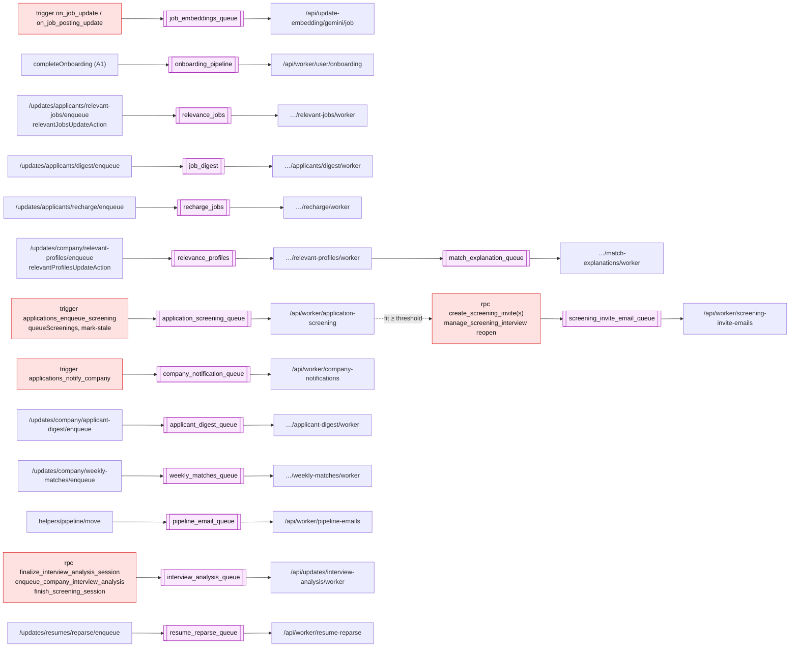
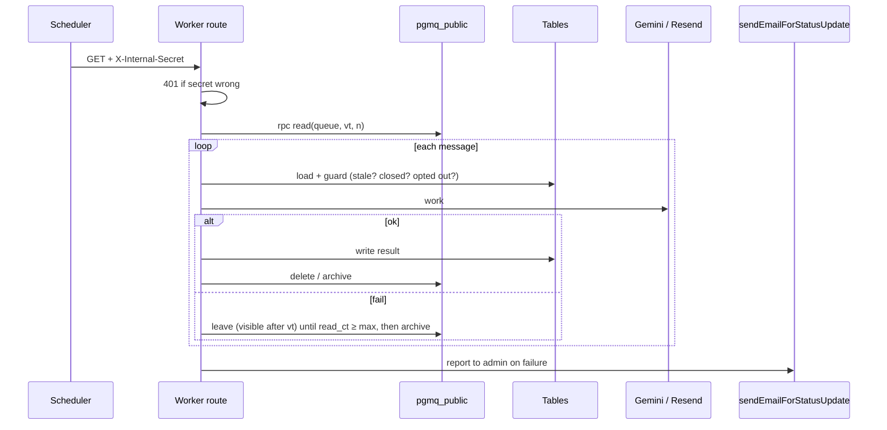

# Background jobs: queues and crons

One scheduler calls the worker routes, with `X-Internal-Secret`:

- **pg_cron** (`net.http_get`, secret from `vault.internal_secret`), defined in `supabase/migrations/`. Most were created **inactive**; `cron.alter_job(..., active := true)` turns one on. The company-side jobs were enabled on prod on 2026-11-07 — the table under Crons has the live state.

**There used to be no complete answer to "who calls this route".** Earlier versions of this doc claimed a second, external scheduler; it doesn't exist (checked 2026-11-07: `.github/workflows` is absent, `cloudbuild.yaml` only builds/pushes/deploys). Two routes have no caller — see the bottom of this file.

## Every queue: producer → queue → worker

## Queue reference

| Queue                          | Created in     | Producer                                                          | Worker                         | Writes / sends                                              |
| ------------------------------ | -------------- | ----------------------------------------------------------------- | ------------------------------ | ----------------------------------------------------------- |
| `job_embeddings_queue`         | live DB only   | job insert triggers (live `send_job_embedding`)                   | `update-embedding/gemini/job`  | `all_jobs` / `job_postings` embeddings                      |
| `onboarding_pipeline`          | live DB only   | `completeOnboarding`                                              | `worker/user/onboarding`       | parse resume, user embedding, `user_relevant_jobs`          |
| `relevance_jobs`               | live DB only   | applicant relevant-jobs enqueue, `relevantJobsUpdateAction`       | applicant relevant-jobs worker | `user_relevant_jobs`                                        |
| `job_digest`                   | live DB only   | applicant digest enqueue                                          | applicant digest worker        | digest email                                                |
| `recharge_jobs`                | live DB only   | recharge enqueue (low `ai_credits`)                               | recharge worker                | recharge email                                              |
| `relevance_profiles`           | live DB only   | company relevant-profiles enqueue, `relevantProfilesUpdateAction` | relevant-profiles worker       | `job_relevant_profiles`, explanation queue                  |
| `match_explanation_queue`      | 20261015130000 | relevant-profiles worker                                          | match-explanations worker      | `job_relevant_profiles.explanation`, usage                  |
| `application_screening_queue`  | 20261015140000 | applications trigger, `queueScreenings`, mark-stale               | application-screening worker   | `application_screenings`, events, invites                   |
| `company_notification_queue`   | 20261015220000 | applications trigger                                              | company-notifications worker   | instant new-applicant email                                 |
| `applicant_digest_queue`       | 20261015220000 | company digest enqueue                                            | company digest worker          | daily digest email                                          |
| `weekly_matches_queue`         | 20261015220000 | weekly-matches enqueue                                            | weekly-matches worker          | weekly email                                                |
| `pipeline_email_queue`         | 20261019150000 | `moveApplications`                                                | pipeline-emails worker         | stage email, `email_sent` event                             |
| `screening_invite_email_queue` | 20261020120000 | invite RPCs, reopen                                               | screening-invite-emails worker | invite email                                                |
| `interview_analysis_queue`     | 20261006210000 | finalize RPC, attachments RPC, `finish_screening_session`         | interview-analysis worker      | `interview_analyses`, emails                                |
| `resume_reparse_queue`         | 20261106130000 | resumes reparse enqueue                                           | `resume-reparse` worker        | `resumes.content` (version 1 → 2), `resume_migration_items` |

## Crons

```mermaid
gantt
  title Cron cadence (UTC), as on prod
  dateFormat HH:mm
  axisFormat %H:%M
  section every minute
  relevant-profiles-worker                 :a3, 00:00, 1m
  company-notifications-worker             :a4, 00:00, 1m
  candidate-embeddings-worker              :a7, 00:00, 1m
  candidate-import-worker                  :a8, 00:00, 1m
  section every 5 / 15 min
  interview-analysis-worker 5m             :a1, 00:00, 5m
  application-screening-worker 5m          :a2, 00:00, 5m
  pipeline-emails-worker 5m                :a5, 00:00, 5m
  screening-invite-emails-worker 5m        :a6, 00:00, 5m
  match-explanations-worker 5m             :b1, 00:00, 5m
  applicant-digest-worker 5m               :b2, 00:00, 5m
  weekly-matches-worker 5m                 :b3, 00:00, 5m
  screening-interviews 15m                 :b4, 00:00, 15m
  section daily / weekly / monthly
  applicant-digest-enqueue daily           :c1, 03:30, 10m
  candidate-imports-expire daily           :c6, 03:30, 10m
  mcp-cleanup daily                        :c7, 03:17, 10m
  weekly-matches-enqueue Mon               :c2, 03:30, 10m
  relevant-profiles-enqueue Mon            :c3, 03:30, 10m
  outreach-expire daily                    :c4, 21:00, 10m
  screening-interviews-retention 1st       :c5, 22:00, 10m
```

Schedules below are what `cron.job` reports on prod (2026-11-07), which is not always the
migration's cadence: several were turned on by hand with `*/5` instead of `* * * * *`.

| pg_cron job                       | Schedule             | Route                                            | Active on prod   |
| --------------------------------- | -------------------- | ------------------------------------------------ | ---------------- |
| interview-analysis-worker         | `*/5 * * * *`        | `/api/updates/interview-analysis/worker`         | yes              |
| match-explanations-worker         | `*/5 * * * *`        | `/api/updates/company/match-explanations/worker` | yes              |
| application-screening-worker      | `*/5 * * * *`        | `/api/worker/application-screening`              | yes              |
| company-notifications-worker      | `* * * * *`          | `/api/worker/company-notifications`              | yes              |
| pipeline-emails-worker            | `*/5 * * * *`        | `/api/worker/pipeline-emails`                    | yes              |
| screening-invite-emails-worker    | `*/5 * * * *`        | `/api/worker/screening-invite-emails`            | yes              |
| relevant-profiles-worker          | `* * * * *`          | `/api/updates/company/relevant-profiles/worker`  | yes (2026-11-07) |
| relevant-profiles-enqueue         | `30 3 * * 1`         | `…/relevant-profiles/enqueue`                    | yes (2026-11-07) |
| applicant-digest-enqueue / worker | `30 3 * * *` / `*/5` | `/api/updates/company/applicant-digest/*`        | yes (2026-11-07) |
| weekly-matches-enqueue / worker   | `30 3 * * 1` / `*/5` | `/api/updates/company/weekly-matches/*`          | yes (2026-11-07) |
| candidate-embeddings-worker       | `* * * * *`          | `/api/worker/candidate-embeddings`               | yes (2026-11-07) |
| candidate-import-worker           | `* * * * *`          | `/api/worker/candidate-import`                   | yes (2026-11-07) |
| candidate-imports-expire          | `30 3 * * *`         | `/api/updates/candidate-imports/expire`          | yes (2026-11-07) |
| screening-interviews              | `*/15 * * * *`       | `/api/updates/screening-interviews`              | yes (2026-11-07) |
| screening-interviews-retention    | `0 22 1 * *`         | `/api/updates/screening-interviews/retention`    | yes (2026-11-07) |
| outreach-expire                   | `0 21 * * *`         | `/api/updates/outreach/expire`                   | yes (2026-11-07) |
| mcp-cleanup                       | `17 3 * * *`         | (inline SQL)                                     | yes              |

Still inactive, and applicant-side only: `recharge enqueue` / `recharge worker` and
`weekly-onboarding-reminder` (kept off on purpose: they'd email ~700 and ~6,500 users), and
`enqueue_pending_embedding_jobs` (not needed while every job has an embedding). The job digest and
relevant-jobs pairs were turned on 2026-11-09 with two-weekly enqueues.

**There is no external scheduler.** Nothing in this repo schedules anything (no `.github/workflows`;
`cloudbuild.yaml` builds, pushes and deploys only). Every route below is reached by a pg_cron job
above, called by `enqueue_missing_job_embeddings`, or has no caller at all.

| Route                                                    | How it's called                                                                           |
| -------------------------------------------------------- | ----------------------------------------------------------------------------------------- |
| `POST /api/update-embedding/gemini/job`                  | `process-job-embedding-queue`, `*/5`                                                      |
| `/api/worker/user/onboarding`                            | `onboarding-pipeline-worker`, `*/3`                                                       |
| `/api/updates/applicants/digest/{enqueue,worker}`        | `weekly-job-digest-test` (`0 8 1,15 * *`, every two weeks), `job-digest-worker` (`*/5`); both active since 2026-11-09 (migration `20261109130000`) |
| `/api/updates/applicants/relevant-jobs/{enqueue,worker}` | `relevant-jobs-update` (`0 8 2,16 * *`, every two weeks) / `relevance-worker` (`*/5`); both active since 2026-11-09 (migration `20261109130000`)                               |
| `/api/updates/applicants/recharge/{enqueue,worker}`      | `recharge enqueue` / `recharge worker` (both inactive)                                    |
| `/api/updates/applicants/applications`                   | `weekly-applications-reminder`, `0 8 * * 2`                                               |
| `/api/updates/applicants/favorites`                      | `weekly-favorites-reminder`, `0 8 * * 6`                                                  |
| `/api/updates/applicants/job-alert`                      | `weekly-bookmark-alert`, `0 0 * * 1`                                                      |
| `/api/updates/applicants/onboarding`                     | `weekly-onboarding-reminder`, `0 8 * * 0` (inactive)                                      |
| **`/api/updates/billing`** (GET or POST)                          | `billing-daily`, `0 3 * * *` (migration `20261109120000`, inactive)                                                         |
| **`/api/updates/knockouts/worker`**                      | `knockouts-worker`, `*/5` (migration `20261109120000`, active since 2026-11-09)                                                          |

The last two are the only worker routes with no caller. Fix plan: `plan/unscheduled-routes-todo.md`.

## Worker pattern

