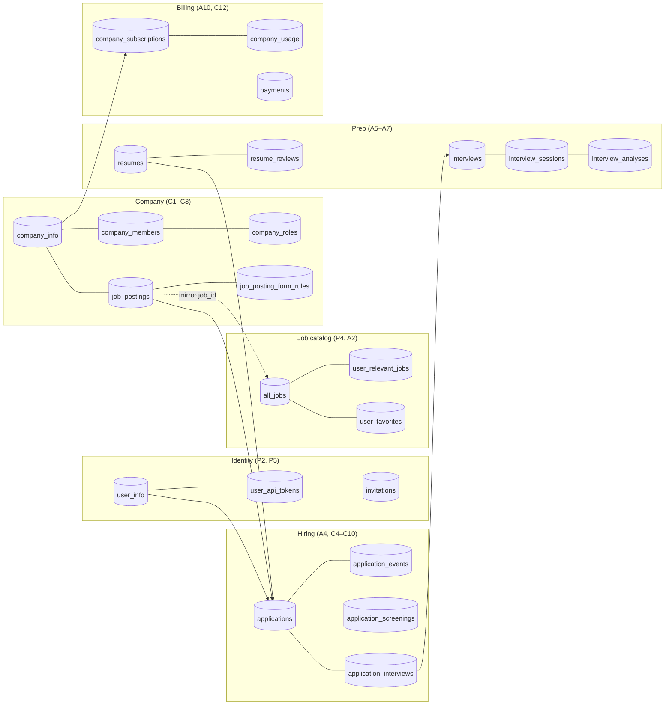

# Inventory by flow

Flow ids point to [01-platform](01-platform.md), [02-applicant](02-applicant.md) and [03-company](03-company.md).

## Data domains

## Tables (67) and views (2)

| Flow | Tables |
|---|---|
| P2 Auth / identity | `user_info`, `invitations`, `waitlist`, `feedbacks` |
| P5 API keys | `user_api_tokens` |
| P4 Ingestion | `all_jobs`, `all_jobs_archive`, `scraper_state` (written by the scraper, not the app) |
| A2 Discovery | `countries_and_cities`, `location_aliases`, `flat_locations` (view), `user_relevant_jobs`, `bookmarks` (≤ 5 alerts) |
| A3 Job page | `user_favorites`, `user_favorites_companies`, `job_feedback` |
| A1/A5 Resumes | `resumes`, `resume_public_sections` |
| A6 Review | `resume_reviews` |
| A7 Practice interview | `interviews`, `interview_sessions`, `interview_analyses` |
| A4/C4 Applications | `applications`, `application_events`, `application_attachments`, `application_knockouts` |
| C5 Screening | `application_screenings` |
| C10 Screening interview | `job_interview_configs`, `application_interviews` (+ `interviews` kind screening) |
| A10 Payments | `payments`, `price_plan`, `billing_webhook_events` |
| A12/C14 Agent | `agent_sessions`, `agent_messages`, `agent_memories` |
| C1 Company | `company_info`, `company_favorites` |
| C2 Team / roles | `company_members`, `company_invites`, `company_roles`, `company_role_permissions`, `company_permissions`, `company_role_limits`, `company_job_assignments`, `company_audit_log` |
| C3 Job posts | `job_postings`, `job_posting_form_rules`, `company_question_sets` |
| C6/C7 Pipeline | `pipeline_stages`, `company_email_templates`, `candidate_notes`, `candidate_note_mentions`, `talent_lists`, `talent_list_members` |
| C8 Search / matching | `candidate_directory` (view), `job_relevant_profiles`, `candidate_profile_views` |
| C9 Outreach | `candidate_outreach`, `candidate_company_blocks`, `outreach_draft_usage` |
| C12 Billing | `company_tiers`, `tier_entitlements`, `company_subscriptions`, `company_usage`, `company_usage_events`, `company_entitlement_holds`, `company_credit_ledger`, `company_billing_audit` |
| C13 Careers | `company_careers_slug_history` (+ careers columns on `company_info`) |

## RPCs called from the app

| Flow | RPCs |
|---|---|
| A2 / A3 | `match_all_jobs_test`, `get_masked_job_urls`, `get_unique_companies`, `get_unique_locations`, `match_all_companies`, `get_unique_companies_company_info`, `get_unique_locations_company_info` |
| A10 credits | `deduct_user_credits`, `deduct_interview_session_credits`, `fulfil_payment` |
| A7 practice | `reserve_interview_session`, `activate_interview_session`, `heartbeat_interview_session`, `release_interview_session`, `finalize_interview_analysis_session` |
| A4 attachments | `enqueue_company_interview_analysis` |
| A8 screening (candidate) | `my_screening_interviews`, `lock_my_screening_interview`, `record_screening_consent`, `request_screening_accommodation`, `decline_screening_interview`, `reserve_screening_attempt`, `start_screening_attempt`, `finish_screening_session` |
| A9 outreach | `respond_to_outreach`, `get_my_profile_view_count` |
| Dashboard | `get_applicant_weekly_metrics`, `get_company_metrics`, `get_recruiter_job_summaries`, `get_platform_stats` |
| Access | `my_company_access`, `touch_company_membership`, `has_company_permission` (RLS), `company_can_view_candidate`, `company_has_candidate_access` |
| C2 team | `create_company_invite`, `accept_company_invite`, `revoke_company_invite`, `set_company_member_role`, `remove_company_member`, `set_company_owner`, `make_primary_owner`, `set_my_display_name`, `member_display_name`, `list_company_team`, `list_company_hiring_teams`, `list_job_hiring_team`, `list_mentionable_members`, `list_company_audit` |
| C2 roles | `create_company_role`, `update_company_role`, `delete_company_role`, `set_default_company_role`, `list_company_roles`, `assign_job`, `unassign_job`, `assign_job_creator` |
| C6 pipeline | `reorder_pipeline_stages`, `pipeline_emails_pending`, `update_company_settings`, `get_job_funnel`, `application_job_id` |
| C7 notes | `claim_note_mention_emails` |
| C8 search | `match_user_profiles`, `get_unique_profile_filters`, `record_profile_view` |
| C9 outreach | `send_candidate_outreach`, `increment_outreach_drafts`, `expire_outreach` |
| C10 interviews | `create_screening_invite`, `create_screening_invites`, `manage_screening_interview`, `expire_screening_interviews` |
| C12 billing | `get_company_entitlements`, `check_entitlement`, `check_member_limit`, `hold_entitlement`, `consume_entitlement`, `release_hold`, `member_usage`, `apply_subscription_event`, `schedule_company_plan_change`, `set_company_cancel_at_period_end`, `grant_company_credits`, `set_company_plan`, `rollover_free_periods`, `billing_usage_alerts`, `mark_usage_notified` |
| C13 careers | `claim_careers_slug`, `save_careers_page`, `set_careers_published`, `get_careers_page`, `get_careers_jobs`, `get_my_careers_page` |
| Queues (`pgmq_public`) | `send`, `send_batch`, `read`, `delete`, `archive` |

Internal-only DB functions (called by triggers, RLS or other functions): `billing_*`, `role_*`, `expand_role_grants`, `write_role_grants`, `within_caller_ceiling`, `company_role`, `company_permission_scope`, `is_company_member`, `is_company_admin`, `caller_is_owner`, `my_company_id`, `my_job_ids_with`, `member_can_view_notes`, `member_limit_state`, `first_pipeline_stage`, `pipeline_kind_for_status`, `application_status_for_kind`, `application_stage_closed`, `screening_turn_counts`, `screening_start_refusal`, `release_screening_hold`, `log_screening_event`, `careers_*`, `slugify_company_name`, `unique_careers_slug`, `legacy_question_id`, `redact_pii`, `resume_sections_public`, `team_invite_hash`, `audit_actor_kind`, `write_company_audit`, `try_uuid`, `seed_*`, `backfill_*`, the `*_search` filter helpers.

## Triggers

```mermaid
flowchart LR
  subgraph applications
    a1["BEFORE protect_application_pipeline_columns"]
    a2["BEFORE applications_sync_status"]
    a3["AFTER INSERT log_application_applied"]
    a4["AFTER INSERT enqueue_application_screening → queue"]
    a5["AFTER INSERT notify_company_of_application → queue"]
    a6["AFTER UPDATE stage_id applications_close_screening_interview"]
    a7["BEFORE UPDATE protect_application_submission_columns"]
  end
  subgraph company_info
    c1["AFTER INSERT create_default_subscription"]
    c2["AFTER INSERT seed_owner_membership"]
    c3["AFTER INSERT seed_company_roles"]
    c4["AFTER INSERT seed_default_pipeline"]
    c5["AFTER INSERT seed_default_templates"]
    c6["BEFORE protect_company_info_columns / careers / digest watermark"]
  end
  subgraph job_postings
    j1["BEFORE enforce_active_job_post_limit"]
    j2["BEFORE UPDATE guard_job_posting_update"]
    j3["AFTER INSERT assign_job_creator_trigger"]
    j4["AFTER INSERT handle_job_posting_embedding → queue"]
  end
  subgraph others
    o1["all_jobs AFTER INSERT handle_job_embedding → queue"]
    o2["resumes AFTER content store_resume_public_sections"]
    o3["company_subscriptions AFTER tier sync_company_info_tier"]
    o4["application_attachments BEFORE check_application_attachment"]
    o5["candidate_outreach BEFORE fill_outreach_sender_name"]
    o6["candidate_notes BEFORE UPDATE guard_candidate_note"]
    o7["pipeline_stages BEFORE UPDATE guard_pipeline_stage"]
    o8["company_role_permissions BEFORE guard_role_permission"]
    o9["company_members / company_invites BEFORE guard_member_role_company"]
    o10["company_question_sets BEFORE INSERT check_question_set_cap"]
    o11["interviews BEFORE interviews_guard_kind"]
    o12["job_interview_configs BEFORE job_interview_configs_set_company"]
    o13["agent_sessions / agent_memories BEFORE UPDATE agent_set_updated_at"]
    o14["user_info BEFORE protect_user_info_columns"]
    o15["invitations BEFORE UPDATE protect_invitation_columns"]
    o16["interviews BEFORE protect_interview_charge_columns"]
    o17["bookmarks BEFORE bookmarks_alert_cap"]
  end
```

## Route handlers by flow

| Flow | Routes |
|---|---|
| P1/P2 | `/auth/callback`, `/auth/confirm`, `/api/current-user` |
| P4 | `/api/update-embedding/gemini/job` |
| P5 | `/api/user/tokens`, `/api/oauth/decision`, `/api/user/profile` |
| P6 | `/api/extension/ensure-user`, `/api/extension/generate-answer` |
| P7 | `/md/[...path]` (markdown pages, reached by the middleware rewrite of `*.md`) |
| A2/A3 | `/api/jobs`, `/api/jobs/filters`, `/api/jobs/urls`, `/api/jobs/[id]/urls`, `/api/jobs/[id]/favorite`, `/api/locations`, `/api/companies`, `/api/companies/filters`, `/api/ai-search/jobs`, `/api/ai-search/jobs/similar-jobs`, `/api/ai-search/jobs/questions/[id]`, `/api/ai-search/companies` |
| A5/A6 | `/api/resumes`, `/api/resumes/[id]`, `/api/resume-review`, `/api/resume-review/[id]` |
| A7/A8 | `/api/interview/start`, `/api/interview/screening/start`, `/api/internal/interview-transcript` |
| A10/C12 | `/api/dodo/create-checkout-session`, `/api/dodo/webhook`, `/api/dodo/download-invoice/[id]`, `/api/company/billing`, `/api/company/billing/checkout`, `/api/internal/billing/grant` |
| A12/C14 | `/api/agent/chat`, `/api/agent/sessions(/[id])`, `/api/agent/memories(/[id])` |
| C3/C5/C6/C10 | `/api/job-posting`, `/api/company/job-posts/[id]/pipeline`, `/screen`, `/interview`, `/api/company/applications/[id]/screening` |
| C8/C9 | `/api/profiles`, `/api/profiles/filters`, `/api/ai-search/profiles`, `/api/company/matches/explain`, `/api/company/outreach` |
| C13 | `/api/careers/[slug]/jobs` |
| Ops | `/api/health`, `/api/debug/heapdump`, `/api/debug/memory`, `/api/keystatic/[...params]` |
| Crons | see [04-background-jobs](04-background-jobs.md) |

## Server actions by flow

| Flow | Actions (`app/actions/…`) |
|---|---|
| P1/P2 | `sign-up-email`, `reset-password-email`, `update-user-metadata`, `clear-router-cache`, `send-invite-credit-email`, `invitations/mark-invite-dialogs-shown`, `send-promotion-email` |
| P3 shared | `update-owned-item`, `delete-owned-item` (rename / delete the user's own resumes, reviews, interviews, API keys, bookmarks), `submit-feedback` |
| A1 | `submit-onboarding`, `upload-resume-file` |
| A2/A3 | `summarize-job`, `jobs-feedback`, `relevant-jobs-update`, `bookmarks/toggle-search-bookmark`, `bookmarks/set-bookmark-alert`, `favorites/set-favorite`, `revalidate-path`, `revalidate-tag` |
| A4 | `submit-application`, `deduct-application-credits`, `applications/track-external-application`, `set-external-application-status`, `remove-external-application`, `preview-agent-application`, `applications/attachments` |
| A5/A6 | `retry-resume-parsing`, `set-primary-resume`, `create-resume-review`, `resume-review/update-review-jd`, `resume-review/link-review-resume`, `mark-review-analysis-failed`, `send-resume-status-email`, `send-review-status-email` |
| A7 | `create-interview`, `interview-session-lock`, `interviews/save-practice-turns`, `deduct-interview-session-credits`, `finalize-interview-session` |
| A8 | `interviews/get-my-screening-interview`, `record-screening-consent`, `request-screening-accommodation`, `decline-screening-interview` |
| A9 | `outreach/respond-to-outreach`, `outreach/set-outreach-preferences` |
| A13 | `user/set-email-preference`, `user/set-profile-visibility` |
| C1 | `company/save-company-profile` |
| C2 | `team/*` (9), `roles/*` (5), `jobs/assign-job`, `jobs/unassign-job`, `audit/list-audit` |
| C3 | `upsert-job-posting`, `set-job-posting-status`, `delete-job-posting`, `jobs/preview-agent-job-delete`, `question-sets/*` |
| C6/C7 | `pipeline/*` (15), `update-application-status` |
| C8 | `relevant-profiles-update`, `favorites/set-profile-favorite` |
| C9 | `outreach/draft-outreach`, `load-composer`, `send-outreach`, `withdraw-outreach`, `preview-agent-outreach` |
| C10 | `interviews/save-interview-config`, `suggest-interview-config`, `invite-to-interview`, `manage-screening-interview`, `preview-agent-interview-invite` |
| C12 | `change-company-plan`, `cancel-company-plan`, `resume-company-plan`, `open-billing-portal` |
| C13 | `careers/claim-careers-slug`, `save-careers-page`, `set-careers-published`, `upload-careers-image` |
