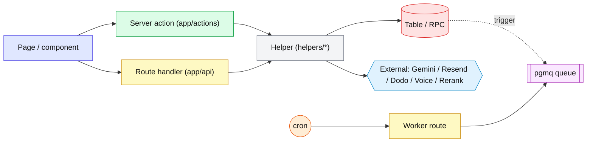
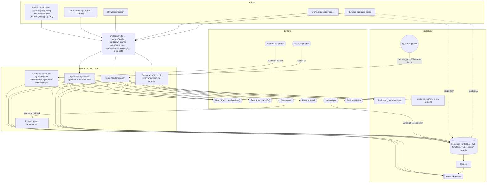
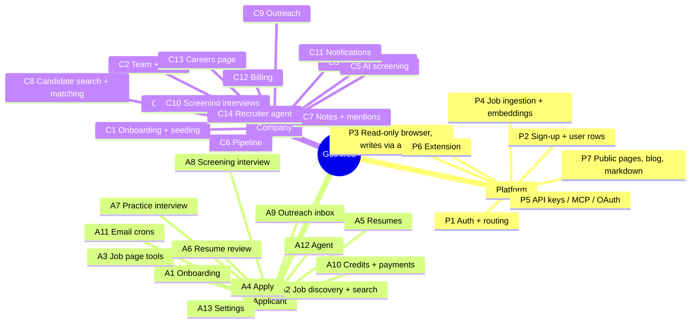

# GetHired: application flows

A map of every end-to-end flow on the applicant and company sides. For each flow it lists the server actions, route handlers, tables, RPCs, triggers, queues and crons it touches. Up to date as of 2026-10-21.

New here? Read [The whole system](#the-whole-system) below, then the journey diagram at the top of [02-applicant](02-applicant.md) or [03-company](03-company.md).

| File | What's in it |
|---|---|
| [01-platform.md](01-platform.md) | Auth and routing, sign-up, the read-only browser client, job ingestion and embeddings, API keys / MCP / extension, public pages |
| [02-applicant.md](02-applicant.md) | Applicant flows A1–A13 |
| [03-company.md](03-company.md) | Company flows C1–C14 |
| [04-background-jobs.md](04-background-jobs.md) | Every queue and cron: producer → queue → worker → effect |
| [05-inventory.md](05-inventory.md) | Tables, RPCs, triggers, routes and server actions, grouped by flow |

## Legend

## The whole system

## Flow index

